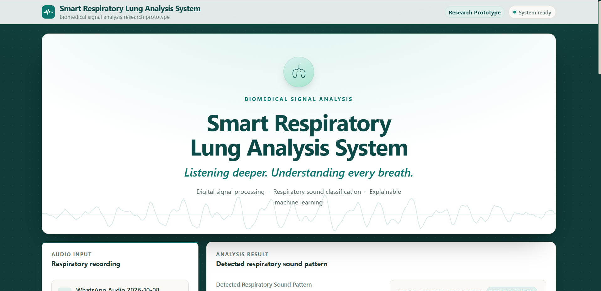
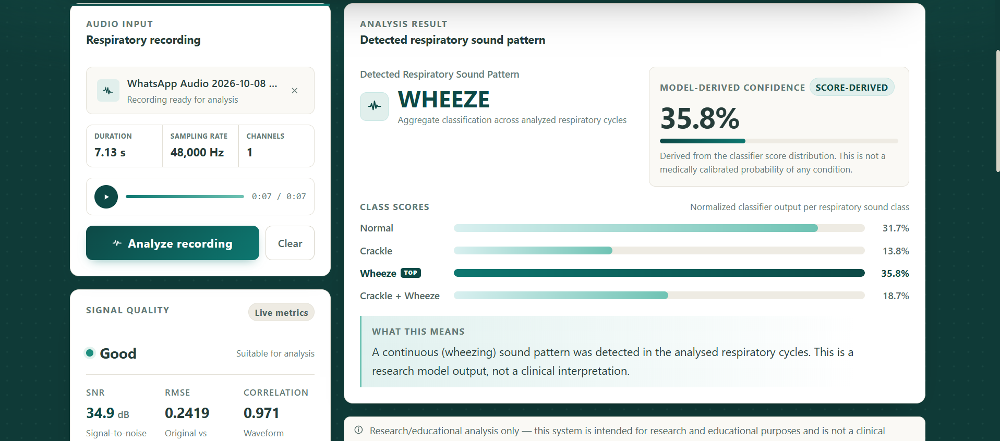
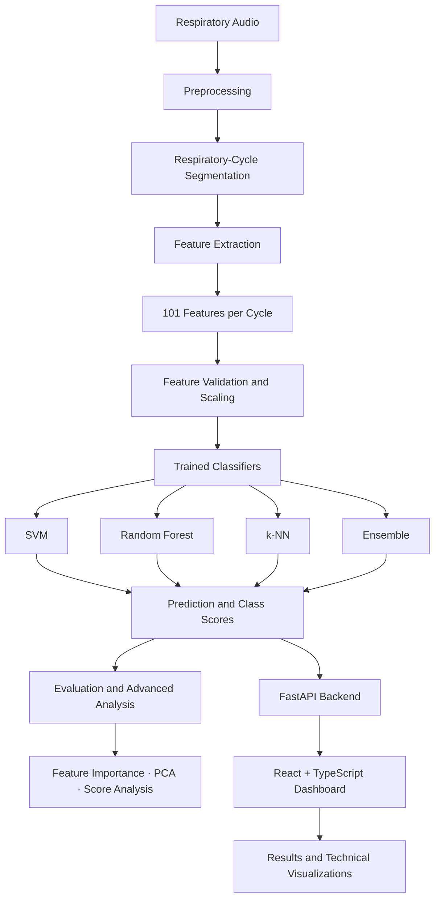

# 🫁 Smart Respiratory Lung Analysis System

<p align="center">
  <strong>Listening deeper. Understanding every breath.</strong>
  <br/>
  A biomedical signal-processing and machine-learning research prototype for respiratory sound analysis.
</p>

<p align="center">
  
  
  
  
  
</p>

---

## 🖥️ Project at a Glance

<p align="center">
  
</p>

**Smart Respiratory Lung Analysis System** is an end-to-end biomedical signal analysis project that combines digital signal processing (DSP), respiratory-cycle analysis, feature engineering, machine learning, and an interactive web dashboard.

Rather than treating a respiratory recording as just an audio file, the system examines its acoustic characteristics, extracts numerical features, and uses trained classifiers to identify respiratory sound patterns.

The project brings together two complementary components:

* **Research pipeline:** MATLAB-based preprocessing, respiratory-cycle segmentation, feature extraction, model training, evaluation, and advanced analysis.
* **Interactive application:** A React and TypeScript dashboard with a FastAPI backend for audio upload, analysis results, signal-quality information, class-score visualizations, and technical details.

The goal is to make respiratory audio analysis more systematic, interpretable, and accessible for experimentation.

> **Research prototype:** This project identifies respiratory sound patterns. It is not a clinically validated diagnostic system, does not diagnose diseases, and must not be used as a substitute for professional medical evaluation.

---

## ✨ Key Features

| Feature                           | What it does                                                                                            |
| --------------------------------- | ------------------------------------------------------------------------------------------------------- |
| 🎙️ Respiratory audio input       | Accepts an audio recording for analysis through the dashboard.                                          |
| 🔊 Signal preprocessing           | Applies signal conditioning and noise-reduction techniques to prepare recordings for analysis.          |
| ✂️ Respiratory-cycle segmentation | Uses annotated recordings to isolate individual respiratory cycles in the research pipeline.            |
| 🧮 101-feature representation     | Extracts a structured feature vector for each analyzed respiratory cycle.                               |
| 🤖 Multiple ML classifiers        | Implements and compares SVM, Random Forest, k-Nearest Neighbors, and Ensemble models.                   |
| 📊 Model evaluation               | Supports quantitative evaluation using classification metrics and confusion matrices.                   |
| 🔍 Feature importance             | Examines which extracted features contribute to model predictions.                                      |
| 🧭 PCA analysis                   | Explores the structure of the extracted feature space through dimensionality reduction.                 |
| 🎯 Score-derived confidence       | Displays classifier-score information with a clear distinction from medically calibrated probabilities. |
| 📈 Signal-quality indicators      | Presents available signal-quality metrics, including SNR, RMSE, and correlation.                        |
| 🌐 Interactive dashboard          | Presents uploaded audio, predictions, class scores, and analysis details in a dedicated interface.      |

---

## 📸 The Dashboard

### 01 — Audio input and system overview

<p align="center">
  
</p>

The dashboard provides a unified workspace for respiratory recording analysis. Its interface is designed around clear audio input, readable results, and a biomedical research aesthetic.

### 02 — Respiratory sound classification and signal quality

<p align="center">
  
</p>

The results interface presents the predicted respiratory sound pattern alongside class-score comparisons, score-derived confidence, and signal-quality information when available.

The interface is intended to make the model output easier to inspect—not to turn a classifier prediction into a clinical conclusion.

---

## 🧠 Respiratory Sound Classes

The classification pipeline works with four respiratory sound-pattern categories:

| Class                | Description                                                            |
| -------------------- | ---------------------------------------------------------------------- |
| **Normal**           | A normal respiratory sound pattern represented in the training labels. |
| **Crackle**          | A respiratory sound pattern labelled as containing crackles.           |
| **Wheeze**           | A respiratory sound pattern labelled as containing wheezes.            |
| **Crackle + Wheeze** | A pattern labelled as containing both crackles and wheezes.            |

These are **acoustic pattern labels**, not diagnoses of asthma, pneumonia, COPD, or any other medical condition.

---

## ⚙️ System Architecture

The project follows a signal-processing-to-classification workflow, with a separate application layer for interactive analysis.



The research pipeline and web application serve different purposes: MATLAB handles the signal-processing and model-analysis workflow, while the web layer provides an interface for interacting with the analysis system.

---

## 🔬 The Research Pipeline

The MATLAB workflow is organized into five main stages.

### Part 1 — Data loading and respiratory-cycle segmentation

* Loads respiratory recordings and their associated annotations.
* Reads annotated cycle start and end times.
* Uses crackle and wheeze labels to identify the target class for each cycle.
* Prepares individual respiratory cycles for subsequent processing.

The annotated dataset makes it possible to analyze respiratory cycles individually rather than assigning a single label to an entire recording without considering its segments.

### Part 2 — Signal processing and noise analysis

* Compares FIR and IIR filtering approaches.
* Applies wavelet-based denoising.
* Examines signal-quality measures.
* Investigates the effect of controlled noise on respiratory audio.

This stage focuses on how signal-processing choices affect the waveform and its suitability for downstream feature extraction.

### Part 3 — Feature extraction

The feature-engineering stage transforms respiratory cycles into structured numerical representations.

The project extracts **101 features per cycle**, drawing on signal characteristics such as:

* Time-domain statistics.
* Frequency-domain characteristics.
* Short-time Fourier transform (STFT) information.
* Mel-frequency cepstral coefficients (MFCCs).
* Wavelet-derived characteristics.

These features provide the machine-learning models with a numerical description of the respiratory sound rather than the raw waveform alone.

### Part 4 — Machine-learning model training and comparison

The project implements four classifier approaches:

* Support Vector Machine (SVM).
* Random Forest.
* k-Nearest Neighbors (k-NN).
* Ensemble classification.

The workflow supports model comparison and saves trained models and associated data for subsequent analysis.

### Part 5 — Advanced model analysis

The final stage investigates the model beyond its predicted class.

* **Feature importance:** explores the contribution of individual features.
* **Principal Component Analysis (PCA):** visualizes patterns in the feature space.
* **Score-derived confidence:** examines the classifier's output-score distribution.
* **Recording/patient-level evaluation:** explores how cycle-level predictions can be aggregated into higher-level results.

These analyses help investigate how the system behaves and where its predictions may need further validation.

---

## 📊 Dataset and Experimental Setup

The research pipeline uses the **ICBHI 2017 Respiratory Sound Database** and its respiratory-cycle annotations.

The annotations provide cycle boundaries and crackle/wheeze labels, enabling supervised classification of respiratory sound patterns.

The existing experimental workflow includes patient-wise dataset splitting to reduce the risk of information leakage between training and test sets.

### Current pipeline scale

| Item            | Project configuration                                      |
| --------------- | ---------------------------------------------------------- |
| Dataset         | ICBHI 2017 Respiratory Sound Database                      |
| Recordings      | 687 training recordings reported in the current experiment |
| Training cycles | 5,326                                                      |
| Test cycles     | 1,572                                                      |
| Features        | 101 per respiratory cycle                                  |
| Classifiers     | SVM, Random Forest, k-NN, Ensemble                         |

These figures describe the current experimental setup and may change if the dataset, preprocessing, filtering, or segmentation configuration changes. They are not claims of model accuracy or clinical performance.

---

## 🛠️ Technology Stack

<p align="center">
  
  
  
  
  
</p>

* **MATLAB:** signal processing, feature extraction, model training, and advanced analysis.
* **React:** interactive user interface.
* **TypeScript:** typed frontend components and API data contracts.
* **FastAPI:** backend API layer for audio analysis.
* **Machine learning:** SVM, Random Forest, k-NN, and Ensemble classifiers.
* **Data analysis:** feature-space exploration, classifier-score analysis, and signal-quality metrics.

---

## 🚀 Getting Started

### Prerequisites

Before running the project, ensure that you have:

* MATLAB with the toolboxes required by the scripts you intend to run.
* The ICBHI respiratory recordings and annotation files for the research pipeline.
* Python and pip for the backend.
* Node.js and npm for the frontend.
* The trained MATLAB model file and any other artifacts required by the inference backend.

> **Note:** The web application depends on the backend and its model artifacts. The instructions below assume that the backend implementation and its MATLAB integration are configured correctly on your machine.

### 1. Clone the repository

```bash
git clone https://github.com/Priyansha29/Smart-Respiratory-Analysis-System.git
cd Smart-Respiratory-Analysis-System
```

### 2. Start the backend

Open a terminal from the repository root:

```bash
cd backend
py -m pip install -r requirements.txt
py -m uvicorn app.main:app --host 127.0.0.1 --port 8000
```

The backend runs locally at:

```text
http://127.0.0.1:8000
```

Allow time for the MATLAB worker and trained models to initialize.

### 3. Start the dashboard

Open a second terminal from the repository root:

```bash
cd dashboard
npm install
npm run dev
```

Open the local dashboard in your browser:

**http://127.0.0.1:5173**

### 4. Analyze a recording

1. Start the backend and confirm that it initializes successfully.
2. Open the dashboard.
3. Select a supported respiratory audio recording.
4. Review the displayed recording information.
5. Run the analysis.
6. Inspect the predicted sound-pattern category, class scores, confidence information, and signal-quality metrics.
7. Explore any additional technical analysis available in the interface.

For backend-specific requirements, endpoint details, and test instructions, see [`backend/README.md`](backend/README.md). For frontend-specific details, see [`dashboard/README.md`](dashboard/README.md).

---

## 📁 Repository Structure

```text
Smart-Respiratory-Analysis-System/
│
├── dashboard/                  # React + TypeScript web application
│   └── README.md               # Frontend-specific documentation
│
├── backend/                    # FastAPI application and inference integration
│   └── README.md               # Backend setup and endpoint documentation
│
├── assets/
│   ├── dashboard-overview.png  # Dashboard screenshot
│   └── analysis-results.png    # Classification results screenshot
│
├── main.m                      # Main MATLAB workflow, if present at repository root
├── README.md                   # Project documentation
└── ...
```

The tree above highlights the main application components. Additional MATLAB scripts, model artifacts, datasets, and supporting files may be organized in other directories in the repository.

---

## 🔎 Important Interpretation Notes

### Class scores are not clinical probabilities

The dashboard may display a score-derived confidence value based on the classifier's output distribution. Unless independently calibrated and validated, this value should **not** be interpreted as the probability that a person has a disease.

### Signal quality is not diagnostic quality

Metrics such as signal-to-noise ratio (SNR), root mean square error (RMSE), and correlation describe selected signal properties. A recording with favourable signal-quality measurements is not necessarily representative of a patient's respiratory health.

### Research evaluation is not clinical validation

Patient-wise splitting can reduce certain forms of data leakage, but it does not establish generalization to every population, recording device, environment, or clinical setting. Further independent validation is required before any clinical application could be considered.

---

## 🎯 Project Goals

This project brings together several areas of engineering:

* Biomedical signal acquisition and analysis.
* Digital signal processing and noise handling.
* Respiratory-cycle segmentation.
* Signal feature engineering.
* Supervised machine learning.
* Model interpretation and evaluation.
* Full-stack application development.
* Integration between a MATLAB research workflow and a web-based interface.

The broader objective is to create a technically transparent foundation for experimenting with respiratory audio analysis and to make the underlying processing pipeline accessible through an interactive application.

---

## 🔮 Future Scope

Potential extensions include:

* More extensive evaluation across independent patient groups and recording environments.
* Improved robustness to background noise and recording-device variation.
* Further investigation of class imbalance and misclassified respiratory cycles.
* Calibration and validation of classifier scores.
* More detailed explanations of individual predictions.
* Efficient inference for longer recordings.
* Exploration of embedded audio acquisition and edge-based signal processing.

These are development directions, not claims that the capabilities are already implemented.

---

## ⚠️ Disclaimer

**Smart Respiratory Lung Analysis System is a research and educational prototype.**

Its outputs describe patterns identified by a machine-learning system trained on labelled respiratory audio. They do not establish the presence or absence of a medical condition and should not guide diagnosis, treatment, or emergency decisions.

---

## 👩‍💻 Author

**Priyansha Gour**

Electronics and Telecommunication Engineering | Biomedical Signal Processing | Machine Learning | Full-Stack Development


---

<p align="center">
  <strong>Listening deeper. Understanding every breath.</strong>
  <br/>
  <em>Signal processing meets machine learning in respiratory sound research.</em>
</p>
